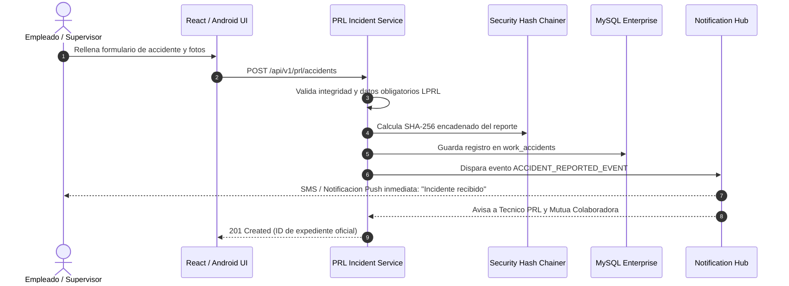
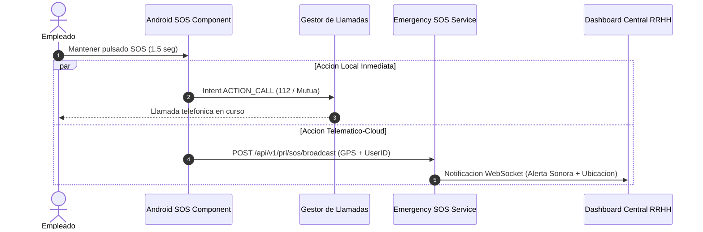
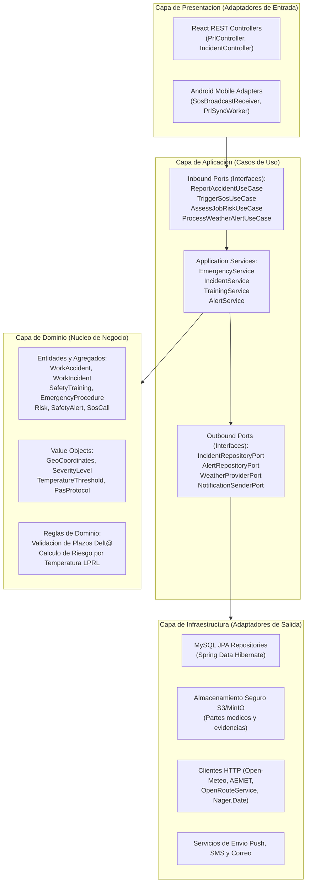
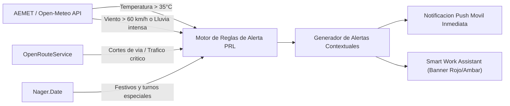
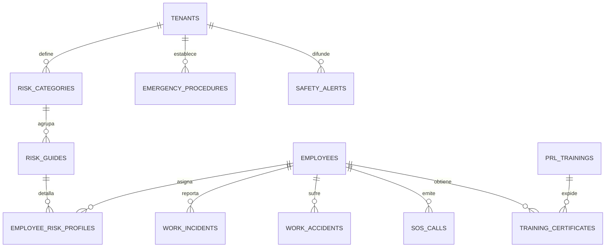

# Modulo: PRL Help Center (Prevencion de Riesgos Laborales)
**Especificacion de Arquitectura Empresarial, Requisitos y Diseno Tecnico**  
**Plataforma Tracker Treball SaaS**  
*Autor: Hassan Adraou, Senior Software Architect*  
*Normativa de Referencia: Ley 31/1995 de Prevencion de Riesgos Laborales (LPRL), Real Decreto 39/1997, Real Decreto 486/1997 y Real Decreto-ley 4/2023*

---

## 1. Descripcion del Modulo

### 1.1. Objetivos Estrategicos y Operativos
El modulo **PRL Help Center** de Tracker Treball extiende la suite de gestion de personal y control horario transformandola en una plataforma integral de seguridad y salud laboral. Sus objetivos primordiales son:
1. **Reduccion activa de la siniestralidad**: Anticipar situaciones de riesgo mediante alertas contextuales en tiempo real antes de que se materialicen en accidentes.
2. **Respuesta inmediata en situaciones de emergencia**: Disminuir el tiempo de reaccion ante accidentes laborales mediante un protocolo SOS directo con transmision de coordenadas y datos medicos basicos.
3. **Cumplimiento legal y blindaje normativo**: Garantizar el cumplimiento exhaustivo de la Ley 31/1995 (LPRL) en Espana, facilitando la integracion telematico-documental exigida por la Inspeccio de Treball de Catalunya (ITC) y el sistema Delt@ (Declaracion Electronica de Trabajadores Accidentados).
4. **Cultura preventiva transversal y gamificada**: Asegurar que cada empleado conoce los riesgos especificos de su puesto de trabajo, los EPIs obligatorios y dispone de sus cursos de formacion preventiva al dia.

### 1.2. Casos de Uso Globales
- Consulta instantanea de guias de primeros auxilios y pautas PAS (Proteger, Avisar, Socorrer).
- Emision de senales de socorro geolocalizadas mediante Boton SOS desde smartphones o tablets quiosco.
- Notificacion y tramitacion inmediata de accidentes laborales leves, graves o in itinere.
- Registro temprano de "casi-accidentes" (*near misses*) para subsanar deficiencias en las instalaciones antes de que causen lesiones.
- Recepcion automatizada de alertas climaticas adversas (estres termico por calor extremo segun RD-ley 4/2023 o temporales).
- Auditoria y control de caducidades de formaciones obligatorias de PRL (articulo 19 de la LPRL).

### 1.3. Matriz de Beneficios por Rol de Usuario

| Rol | Beneficios Principales |
| :--- | :--- |
| **Empleados** | Acceso en menos de 2 clics a pautas de actuacion en emergencias; boton SOS con marcacion directa al 112 y mutua laboral; transparencia total sobre los riesgos de su puesto y recordatorios de salud preventiva. |
| **Supervisores / Managers** | Notificacion inmediata cuando un miembro de su equipo sufre un incidente o pulsa el boton SOS; control en tiempo real de la plantilla presente durante una evacuacion mediante el censo de fichajes activos. |
| **Recursos Humanos y Tecnicos PRL** | Centralizacion documental de evaluaciones de riesgos y firmas de entrega de EPIs; trazabilidad de certificados formativos con alertas de caducidad; reduccion del tiempo administrativo para la generacion del parte oficial Delt@. |
| **Auditores e Inspeccion de Trabajo** | Trazabilidad inalterable con sellado de tiempo de las comunicaciones de riesgo, la imparticion de cursos obligatorios y las medidas preventivas adoptadas frente a alertas climaticas oficiales. |

### 1.4. Impacto en la Seguridad Laboral
Tracker Treball rompe el modelo tradicional de la PRL pasiva (documentos en papel almacenados en archivadores) sustituyendolo por un **sistema proactivo impulsado por eventos**. El cruce de variables (horario de fichaje, localizacion geografica, puesto de trabajo y datos meteorologicos) permite proteger al empleado antes de que inicie una actividad peligrosa.

---

## 2. Requisitos Funcionales

- **RF-PRL-001 (Acceso al Centro de Ayuda)**: El sistema debe ofrecer un punto de acceso unico y visible desde cualquier pantalla de la web y la aplicacion Android para consultar los recursos de prevencion y emergencias.
- **RF-PRL-002 (Consulta de procedimientos de emergencia)**: Los usuarios deben poder acceder a los planes de autoproteccion y protocolos de actuacion ante incendios, escapes quimicos o amenazas fisicas clasificados por centro de trabajo.
- **RF-PRL-003 (Primeros auxilios)**: La aplicacion debe incorporar una guia de soporte vital basico y maniobras de primeros auxilios disponible incluso en modo sin conexion (*offline*) en el dispositivo movil.
- **RF-PRL-004 (Notificacion de accidentes laborales)**: Formulario asistido para declarar un accidente laboral con y sin baja medica, registrando fecha, hora, lugar exacto, descripcion de los hechos, testigos y lesiones aparentes.
- **RF-PRL-005 (Registro de incidentes)**: Mecanismo para reportar actos o condiciones inseguras (*near misses*) con posibilidad de adjuntar fotografias desde el movil para investigacion preventiva.
- **RF-PRL-006 (Alertas meteorologicas)**: Generacion y difusion automatica de avisos de seguridad al detectarse condiciones adversas (calor extremo superior a 35 grados, tormentas o rachas de viento) basadas en AEMET y Open-Meteo.
- **RF-PRL-007 (Protocolos de evacuacion)**: Visualizacion del plano del centro de trabajo con senalizacion de salidas de emergencia, extintores y puntos de encuentro designados en el exterior.
- **RF-PRL-008 (Gestion documental PRL)**: Repositorio digital seguro para almacenar y asociar al expediente del trabajador la acreditacion de entrega de Equipos de Proteccion Individual (EPIs) y la aceptacion de normas de seguridad firmadas digitalmente.
- **RF-PRL-009 (Consulta de formacion obligatoria)**: Visualizacion del estado de las formaciones de PRL exigidas por convenio segun el puesto (Completada, Pendiente, Caducada) con descarga de diplomas en PDF.
- **RF-PRL-010 (Boton SOS)**: Accion de emergencia de maximo nivel que activa la marcacion telefonica prioritaria con los servicios de emergencia (112 y centro asistencial de la Mutua Colaboradora) y envia una alerta inmediata con coordenadas GPS a los supervisores del centro.
- **RF-PRL-011 (Consulta de riesgos por puesto de trabajo)**: Ficha individualizada con los riesgos especificos asociados a la ocupacion laboral (riesgo ergonomico, caidas a distinto nivel, ruido, pantallas de visualizacion de datos - PVD) y sus medidas preventivas.
- **RF-PRL-012 (Recomendaciones de seguridad contextualizadas)**: Motor de sugerencias que emite recordatorios en la pantalla de bienvenida y en el Smart Work Assistant en funcion del puesto, la meteorologia del dia y la duracion de la jornada.

---

## 3. Requisitos No Funcionales

- **RNF-PRL-01 (Alta Disponibilidad)**: Nivel de servicio del 99.95% para el servicio de backend. En la app Android, los modulos criticos (Primeros Auxilios, Guia de Emergencias y Boton SOS) deben operar en memoria local de forma totalmente autonoma sin depender de la conectividad de red.
- **RNF-PRL-02 (Accesibilidad WCAG 2.1 Nivel AA)**: Contrastes de color certificados, compatibilidad con lectores de pantalla (TalkBack en Android, NVDA/VoiceOver en web) y tipografias de alto rango de legibilidad.
- **RNF-PRL-03 (Soporte Bilingue Institucional)**: Disponibilidad al 100% en catalan (`ca`) y castellano (`es`), con terminologia juridica laboral conforme a la Generalitat de Catalunya y al Ministerio de Trabajo.
- **RNF-PRL-04 (Rendimiento y Latencia)**: Tiempo de respuesta inferior a 2 segundos en el 95% de las peticiones REST. El envio del paquete telematico de disparo del Boton SOS debe completarse en menos de 500 milisegundos tras la confirmacion.
- **RNF-PRL-05 (Compatibilidad Multiplataforma)**: Frontend web responsive optimizado para navegadores modernos (Chrome, Firefox, Safari, Edge) y aplicacion Android nativa compatible desde Android 8.0 (API level 26) en adelante.
- **RNF-PRL-06 (Trazabilidad e Inmutabilidad Forense)**: Todo reporte de accidente, incidente o llamada SOS debe registrarse con identificador UUIDv4, huella criptografica SHA-256 encadenada, direccion IP, sellado de tiempo UTC inmutable y auditoria de accesos conforme a la ISO 27001 y al RGPD.

---

## 4. Casos de Uso del Modulo PRL

### CU-PRL-01: Consultar Ayuda de Emergencia
- **Actor Principal**: Empleado.
- **Precondicion**: El usuario tiene la sesion iniciada o se encuentra ante el terminal Quiosco en modo emergencia.
- **Flujo Principal**:
  1. El empleado pulsa sobre "Procedimientos de Emergencia".
  2. El sistema detecta el centro de trabajo asignado y despliega los protocolos pertinentes (Incendio, Evacuacion, Primeros Auxilios).
  3. El usuario selecciona "Primeros Auxilios".
  4. La interfaz renderiza el arbol de decisiones del protocolo PAS en formato interactivo simplificado.
- **Postcondicion**: El empleado visualiza las instrucciones claras de actuacion sin necesidad de conexion externa.

### CU-PRL-02: Reportar Accidente Laboral
- **Actor Principal**: Empleado afectado, Testigo o Supervisor.
- **Precondicion**: Ocurrencia de un suceso danoso durante la jornada de trabajo o en trayecto in itinere.
- **Flujo Principal**:
  1. El usuario accede al formulario de "Declaracion de Accidente".
  2. Indica la fecha, hora exacta del suceso y tipo de accidente (En centro de trabajo / In Itinere / En desplazamiento laboral).
  3. El sistema autocompleta la ubicacion del centro o solicita coordenadas GPS.
  4. El usuario describe la mecanica del accidente, parte del cuerpo afectada y si precisa asistencia de la mutua.
  5. Se pueden adjuntar hasta 4 fotografias del entorno.
  6. El usuario confirma el envio.
  7. El sistema almacena el registro en estado "PENDIENTE_INVESTIGACION", sella el hash SHA-256 y despacha notificaciones prioritarias al correo y SMS del Responsable de PRL y Manager.
- **Postcondicion**: Accidente registrado en el libro de incidencias y listo para tramitacion telematico-laboral.



### CU-PRL-03: Solicitar Asistencia Urgente (Boton SOS)
- **Actor Principal**: Empleado en situacion de peligro grave o testigo de accidente critico.
- **Precondicion**: Acceso al dispositivo movil o terminal de pared.
- **Flujo Principal**:
  1. El usuario pulsa y mantiene presionado el "Boton SOS" durante 1.5 segundos (mecanismo anti-pulsacion accidental).
  2. La aplicacion captura instantaneamente la geolocalizacion precisa y la hora UTC del reloj no manipulable.
  3. El dispositivo lanza en primer plano la llamada telefonica al 112 / Centro Asistencial de la Mutua.
  4. En paralelo, un hilo de ejecucion asincrono envia al servidor un paquete de emergencia con el ID del empleado, centro de trabajo y coordenadas.
  5. El servidor activa el protocolo de emergencia sonoro y visual en el panel de administracion del centro.
- **Postcondicion**: Alerta de socorro emitida y llamada de voz establecida con los servicios de rescate.



### CU-PRL-04: Consultar Procedimientos PRL
- Permite acceder a fichas tecnicas descargables en PDF/A relativas a prevencion por tipo de tarea (trabajos en altura, manipulacion manual de cargas, riesgo electrico).

### CU-PRL-05: Consultar Formacion Pendiente
- El empleado visualiza el itinerario formativo exigido por su puesto segun convenio, comprobando si su certificado de PRL basico (50/60 horas) o especifico se encuentra activo o proximo a caducar.

### CU-PRL-06: Consultar Alertas de Seguridad
- El usuario consulta en tiempo real los avisos meteorologicos o de seguridad interna activos en su centro de trabajo.

---

## 5. Modulos del Sistema

```text
com.trackertreball.prl
├── HelpCenter
│   ├── FaqService
│   └── SafetyGuideProvider
├── FirstAidCenter
│   ├── PasProtocolHandler
│   └── OfflineFirstAidCache
├── EmergencyProcedures
│   ├── EvacuationPlanManager
│   └── SafeMeetingPointRegistry
├── RiskAssessments
│   ├── JobRiskProfileService
│   └── EpiRequirementCatalog
├── SafetyAlerts
│   ├── WeatherAlertEngine
│   ├── HeatStressCalculator
│   └── AlertNotificationDispatcher
├── TrainingCenter
│   ├── ObligatoryCourseMatrix
│   └── CertificateExpirationWatcher
├── IncidentManagement
│   ├── NearMissRecorder
│   ├── InvestigationWorkflowEngine
│   └── DeltaReportExporter
├── DigitalDocumentation
│   ├── EpiHandoverReceiptSigner
│   └── MedicalFitnessDocumentStore
└── SOSEmergencyService
    ├── EmergencyLocationBeacon
    └── CriticalDispatcherClient
```

---

## 6. Arquitectura Hexagonal (Ports and Adapters)

El modulo de PRL se desacopla mediante Arquitectura Hexagonal para asegurar que la logica de negocio permanezca pura, testeable e inmune a cambios tecnologicos en bases de datos o librerias de terceros:



### Clases Principales de la Capa de Dominio
- `WorkAccident`: Agregado principal que encapsula el estado del accidente, las lesiones, la clasificacion de gravedad y el sellado de tiempo de creacion inmutable.
- `SafetyAlert`: Entidad de aviso de seguridad que calcula su vigencia y severidad segun parametros de medicion fisica (temperatura, velocidad del viento, lluvia acumulada).
- `EmergencyProcedure`: Modela los pasos cronologicos a seguir ante una contingencia especifica.

---

## 7. Integraciones Externas y Generacion Automatizada de Alertas

El modulo incorpora conectores inteligentes con servicios abiertos para vigilar de forma desatendida las condiciones del entorno y generar alertas automaticas:



### Reglas de Negocio Implementadas

1. **Alerta de Calor Extremo (Cumplimiento Real Decreto-ley 4/2023)**:
   - *Condicion*: Si la temperatura ambiente prevista por Open-Meteo/AEMET supera los 35°C en la coordenada del centro de trabajo o de la obra.
   - *Accion Automatica*: Emision de la alerta "Alerta de calor extremo". El sistema notifica al supervisor, ordena la interrupcion de tareas pesadas al aire libre en las horas centrales, activa recordatorios de hidratacion obligatoria en la app del empleado y ajusta los intervalos de pausas reglamentarias.
2. **Alerta de Riesgo en Desplazamiento (In Itinere)**:
   - *Condicion*: Si OpenRouteService o AEMET detectan precipitaciones torrenciales (>30 mm/h) o retenciones graves en las arterias de comunicacion vinculadas al centro (ejemplo: corte de la C-17 hacia Vic).
   - *Accion Automatica*: Alerta preventiva "Riesgo meteorologico en desplazamiento". Recomendacion automatica de teletrabajo a la plantilla habilitada o flexibilidad en el fichaje de entrada sin penalizacion de jornada.
3. **Alerta de Trabajos en Altura con Viento**:
   - *Condicion*: Rachas de viento superiores a 50 km/h.
   - *Accion Automatica*: Notificacion de suspension preventiva de trabajos sobre andamios o plataformas elevadoras.

---

## 8. Diseno del Modelo de Datos (MySQL 8)

### 8.1. Diagrama Entidad-Relacion (Mermaid ERD)



### 8.2. Definicion DDL Estructurada en SQL

```sql
-- 1. Categorias de Riesgos Laborales (Ergonomicos, Quimicos, Fisicos, Psicosociales)
CREATE TABLE risk_categories (
    id BIGINT AUTO_INCREMENT PRIMARY KEY,
    tenant_id VARCHAR(36) NOT NULL,
    code VARCHAR(30) NOT NULL,
    name_ca VARCHAR(100) NOT NULL,
    name_es VARCHAR(100) NOT NULL,
    description TEXT NULL,
    created_at TIMESTAMP DEFAULT CURRENT_TIMESTAMP
) ENGINE=InnoDB DEFAULT CHARSET=utf8mb4;

-- 2. Guias y Fichas de Riesgo Especificas
CREATE TABLE risk_guides (
    id BIGINT AUTO_INCREMENT PRIMARY KEY,
    category_id BIGINT NOT NULL,
    title_ca VARCHAR(150) NOT NULL,
    title_es VARCHAR(150) NOT NULL,
    preventive_measures TEXT NOT NULL,
    required_epis VARCHAR(255) NULL,
    severity_level ENUM('LOW', 'MEDIUM', 'HIGH', 'VERY_HIGH') NOT NULL DEFAULT 'LOW',
    CONSTRAINT fk_guide_cat FOREIGN KEY (category_id) REFERENCES risk_categories(id)
) ENGINE=InnoDB DEFAULT CHARSET=utf8mb4;

-- 3. Procedimientos de Emergencia y Evacuacion
CREATE TABLE emergency_procedures (
    id BIGINT AUTO_INCREMENT PRIMARY KEY,
    tenant_id VARCHAR(36) NOT NULL,
    work_center_id BIGINT NOT NULL,
    title VARCHAR(120) NOT NULL,
    protocol_type ENUM('FIRE', 'EVACUATION', 'FIRST_AID', 'HAZARDOUS_SPILL', 'INTRUSION') NOT NULL,
    steps_json JSON NOT NULL,
    pdf_attachment_url VARCHAR(255) NULL,
    meeting_point_coordinates VARCHAR(50) NULL,
    updated_at TIMESTAMP DEFAULT CURRENT_TIMESTAMP ON UPDATE CURRENT_TIMESTAMP
) ENGINE=InnoDB DEFAULT CHARSET=utf8mb4;

-- 4. Registro de Incidentes y Cuasi-Accidentes (Near Misses)
CREATE TABLE work_incidents (
    id VARCHAR(36) PRIMARY KEY,
    tenant_id VARCHAR(36) NOT NULL,
    reporter_employee_id BIGINT NOT NULL,
    incident_date TIMESTAMP NOT NULL,
    location_description VARCHAR(200) NOT NULL,
    hazard_description TEXT NOT NULL,
    suggested_action TEXT NULL,
    photo_evidence_url VARCHAR(255) NULL,
    status ENUM('REPORTED', 'INVESTIGATING', 'CORRECTED', 'ARCHIVED') NOT NULL DEFAULT 'REPORTED',
    created_at TIMESTAMP DEFAULT CURRENT_TIMESTAMP
) ENGINE=InnoDB DEFAULT CHARSET=utf8mb4;

-- 5. Registro Oficial de Accidentes Laborales (Preparado para Sistema Delt@)
CREATE TABLE work_accidents (
    id VARCHAR(36) PRIMARY KEY,
    tenant_id VARCHAR(36) NOT NULL,
    victim_employee_id BIGINT NOT NULL,
    accident_timestamp TIMESTAMP NOT NULL,
    accident_type ENUM('IN_WORKPLACE', 'IN_ITINERE', 'ON_MISSION') NOT NULL,
    with_medical_leave BOOLEAN NOT NULL DEFAULT FALSE,
    severity ENUM('MINOR', 'SERIOUS', 'VERY_SERIOUS', 'FATAL') NOT NULL DEFAULT 'MINOR',
    injured_body_part VARCHAR(100) NOT NULL,
    event_description TEXT NOT NULL,
    witnesses_detail TEXT NULL,
    mutual_assistance_center VARCHAR(150) NULL,
    delta_code VARCHAR(50) NULL COMMENT 'Codigo oficial de registro telematico Delt@',
    record_hash VARCHAR(64) NOT NULL,
    created_at TIMESTAMP DEFAULT CURRENT_TIMESTAMP
) ENGINE=InnoDB DEFAULT CHARSET=utf8mb4;

-- 6. Catalogo de Cursos y Formaciones de PRL
CREATE TABLE prl_trainings (
    id BIGINT AUTO_INCREMENT PRIMARY KEY,
    tenant_id VARCHAR(36) NOT NULL,
    course_code VARCHAR(30) NOT NULL,
    title VARCHAR(150) NOT NULL,
    duration_hours INT NOT NULL,
    validity_months INT NOT NULL DEFAULT 36,
    is_mandatory_by_law BOOLEAN NOT NULL DEFAULT TRUE
) ENGINE=InnoDB DEFAULT CHARSET=utf8mb4;

-- 7. Certificados de Formacion del Trabajador
CREATE TABLE training_certificates (
    id BIGINT AUTO_INCREMENT PRIMARY KEY,
    training_id BIGINT NOT NULL,
    employee_id BIGINT NOT NULL,
    completion_date DATE NOT NULL,
    expiration_date DATE NOT NULL,
    certificate_pdf_url VARCHAR(255) NOT NULL,
    is_valid BOOLEAN NOT NULL DEFAULT TRUE,
    CONSTRAINT fk_cert_training FOREIGN KEY (training_id) REFERENCES prl_trainings(id),
    INDEX idx_emp_cert (employee_id, expiration_date)
) ENGINE=InnoDB DEFAULT CHARSET=utf8mb4;

-- 8. Alertas Activas de Seguridad
CREATE TABLE safety_alerts (
    id BIGINT AUTO_INCREMENT PRIMARY KEY,
    tenant_id VARCHAR(36) NOT NULL,
    source ENUM('SYSTEM_WEATHER', 'AEMET', 'MANUAL_OFFICER', 'FIRE_SENSOR') NOT NULL,
    alert_level ENUM('INFO', 'WARNING', 'DANGER', 'CRITICAL') NOT NULL,
    title VARCHAR(150) NOT NULL,
    message TEXT NOT NULL,
    effective_start TIMESTAMP NOT NULL,
    effective_end TIMESTAMP NOT NULL,
    is_acknowledged_by_employee BOOLEAN DEFAULT FALSE
) ENGINE=InnoDB DEFAULT CHARSET=utf8mb4;

-- 9. Registro de Disparos del Boton SOS
CREATE TABLE sos_calls (
    id VARCHAR(36) PRIMARY KEY,
    tenant_id VARCHAR(36) NOT NULL,
    employee_id BIGINT NOT NULL,
    call_timestamp TIMESTAMP NOT NULL,
    latitude DECIMAL(10, 8) NOT NULL,
    longitude DECIMAL(11, 8) NOT NULL,
    device_battery_percentage INT NULL,
    emergency_service_called VARCHAR(30) DEFAULT '112 / MUTUA',
    status ENUM('DISPATCHED', 'ACKNOWLEDGED_BY_SUPERVISOR', 'RESOLVED', 'FALSE_ALARM') NOT NULL DEFAULT 'DISPATCHED',
    resolution_notes TEXT NULL
) ENGINE=InnoDB DEFAULT CHARSET=utf8mb4;

-- 10. Perfil de Riesgos por Puesto del Empleado
CREATE TABLE employee_risk_profiles (
    id BIGINT AUTO_INCREMENT PRIMARY KEY,
    employee_id BIGINT NOT NULL,
    risk_guide_id BIGINT NOT NULL,
    assigned_date DATE NOT NULL,
    epis_delivered BOOLEAN NOT NULL DEFAULT FALSE,
    delivery_signed_at TIMESTAMP NULL,
    CONSTRAINT fk_prof_guide FOREIGN KEY (risk_guide_id) REFERENCES risk_guides(id),
    UNIQUE KEY uk_emp_risk (employee_id, risk_guide_id)
) ENGINE=InnoDB DEFAULT CHARSET=utf8mb4;
```

---

## 9. Dashboard Central de Prevencion de Riesgos (PRL)

El panel directivo para los tecnicos de seguridad y departamentos de Recursos Humanos centraliza las siguientes tarjetas de control y KPIs:

```text
+-------------------------------------------------------------------------------------------------------+
| DASHBOARD GENERAL DE PREVENCION DE RIESGOS LABORALES (PRL)                     Tracker Treball        |
+-------------------------------------------------------------------------------------------------------+
| [ KPI 1: DIAS SIN ACCIDENTES ]  | [ KPI 2: INCIDENTES (MES) ]      | [ KPI 3: COBERTURA FORMACION ]   |
| 145 dias consecutivos           | Abiertos: 2  |  Cerrados: 14     | 94.2% Plantilla certificada      |
| Record historico: 210 dias      | Tiempo medio resolucion: 48h     | 6 Cursos proximos a caducar      |
+-------------------------------------------------------------------------------------------------------+
| [ ALERTAS DE SEGURIDAD ACTIVAS ]                                   | [ INDICES DE SINIESTRALIDAD ]    |
| [ALERTA AMBAR] AEMET: Calor extremo > 35°C en Vic (13:00 - 18:00)  | Indice de Frecuencia (IF): 4.12  |
| Medida: Pausas adicionales de 15m e hidratacion en planta          | Indice de Gravedad (IG): 0.08    |
+-------------------------------------------------------------------------------------------------------+
```

### Definicion de Metricas Clave
1. **Dias sin accidentes**: Contador continuo que se reinicia unicamente ante accidentes con baja medica.
2. **Incidentes Abiertos vs Cerrados**: Control de resolucion de casi-accidentes para garantizar que ninguna situacion de peligro reportada quede sin subsanar.
3. **Tasa de Cobertura de Formacion**: Porcentaje de empleados con todos los cursos de PRL obligatorios de su puesto vigentes.
4. **Indice de Frecuencia (IF)**: Medida estandarizada segun el INSST:  
   `IF = (Numero de accidentes con baja * 1.000.000) / Total de horas-hombre trabajadas`.
5. **Indice de Gravedad (IG)**:  
   `IG = (Jornadas no trabajadas por baja * 1.000) / Total de horas-hombre trabajadas`.

---

## 10. Modulo Smart Safety Assistant (Asistente Preventivo Contextual)

Integrado en la parte superior del **Smart Work Assistant**, este subcomponente analiza de forma desatendida las condiciones especificas del dia para emitir recomendaciones preventivas de impacto inmediato:

```text
+-------------------------------------------------------------------------------------+
| ASISTENTE PREVENTIVO INTELIGENTE (SMART SAFETY ASSISTANT)                           |
+-------------------------------------------------------------------------------------+
| Puesto: Mozo de Almacen / Logistica                   Ubicacion: Nave 2 - Vic (BCN) |
|                                                                                     |
| [AVISO METEOROLOGICO] Temperatura prevista en nave: 36°C (Nivel de Alerta Naranja) |
|                                                                                     |
| RECOMENDACIONES PREVENTIVAS ACTIVAS:                                                |
| [OBLIGATORIO] Protocolo RD-ley 4/2023: Pausa de recuperacion de 10 min cada hora     |
| [OBLIGATORIO] Ingestion minima de agua recomendada: 500 ml cada 45 minutos         |
| [EPI ACTIVO] Utilizar calzado de seguridad transpirable y chaleco reflectante ligero|
|                                                                                     |
| ESTADO PREVENTIVO INDIVIDUAL:                                                       |
| - Formacion PRL en carretillas elevadoras: VIGENTE (Caduca en 14 meses)             |
| - Reconocimiento medico anual: APTO (Realizado el 15/03/2026)                       |
| - Dias de tu centro sin accidentes: 145 dias                                        |
+-------------------------------------------------------------------------------------+
```

---

## 11. Wireframes Textuales de Interfaces (Web y Android)

### 11.1. Centro de Ayuda y Emergencias PRL (Vista Web y Tablet)
```text
+-----------------------------------------------------------------------------------+
| TRACKER TREBALL | PRL HELP CENTER                             [IDIOMA: CA | ES]   |
+-----------------------------------------------------------------------------------+
| [!] BOTON SOS: ASISTENCIA INMEDIATA (PULSAR PARA LLAMADA 112 Y MUTUA)              |
+-----------------------------------------------------------------------------------+
| SECCIONES PRINCIPALES:                                                            |
|                                                                                   |
| [1] PRIMEROS AUXILIOS (METODO PAS)          [2] PROCEDIMIENTOS DE EVACUACION      |
| - Guia de soporte vital y RCP               - Planos del centro de trabajo        |
| - Actuacion ante quemaduras y cortes        - Salidas de emergencia y extintores  |
| - Desfibriladores DEA mas cercanos          - Punto de encuentro exterior         |
|                                                                                   |
| [3] DECLARAR ACCIDENTE / INCIDENTE          [4] FICHAS DE RIESGO DE MI PUESTO     |
| - Reportar accidente laboral                - Riesgos especificos evaluados       |
| - Notificar condicion peligrosa (foto)      - EPIS obligatorios asignados         |
|                                                                                   |
| [5] MIS FORMACIONES DE SEGURIDAD            [6] CONTACTOS DE EMERGENCIA           |
| - Certificado PRL Basico (Completado)       - Medico de guardia: Ext. 402         |
| - Prevencion ergonomica (Pendiente)         - Mutua Laboral: 900 100 200          |
+-----------------------------------------------------------------------------------+
```

### 11.2. Pantalla SOS de Emergencia (Android Smartphone)
```text
+---------------------------------------------------+
| TRACKER TREBALL MOBILE                   SOS MODE |
+---------------------------------------------------+
|                                                   |
|           [ BOTON ROJO CIRCULAR SOS ]             |
|          MANTENER PULSADO 1.5 SEGUNDOS            |
|                                                   |
| Accion inmediata:                                 |
| - Conecta llamada de voz prioritaria al 112       |
| - Notifica a los supervisores de planta           |
| - Transmite coordenadas GPS exactas               |
|                                                   |
| Coordenadas actuales: 41.9304 N, 2.2541 E (Vic)  |
| Bateria del dispositivo: 84%                      |
|                                                   |
| CONTACTOS RAPIDOS ALTERNATIVOS:                   |
| [ Llamar a Mutua Asistencial ]                    |
| [ Avisar a Brigada de Primeros Auxilios Centro ]  |
+---------------------------------------------------+
```

### 11.3. Formulario de Registro de Incidente (Reporte de Near Miss)
```text
+-----------------------------------------------------------------------------------+
| REGISTRO DE CONDICION PELIGROSA O INCIDENTE PREVENTIVO                            |
+-----------------------------------------------------------------------------------+
| Fecha y hora: 02/11/2026 - 12:40 (Autocompletado)                                  |
| Centro de trabajo: Almacen Logistico Central - Vic                                |
| Zona exacta: Pasillo de estanterias D-04                                          |
|                                                                                   |
| Tipo de peligro observado:                                                        |
| ( ) Suelo resbaladizo / derrame liquido                                           |
| (X) Obstaculo en salida de evacuacion o paso peatonal                             |
| ( ) Deficiencia en cuadro electrico o maquinaria                                  |
| ( ) Falta de iluminacion                                                          |
|                                                                                   |
| Descripcion detallada:                                                            |
| [ Palet de mercancia bloqueando la puerta corta-fuegos lateral ]                 |
|                                                                                   |
| Evidencia fotografica:                                                            |
| [ Boton: Adjuntar fotografia desde la camara ]  -> Archivo: evidencia_01.jpg    |
|                                                                                   |
| [ Cancelar ]                             [ Guardar y Notificar a Tecnico PRL ]    |
+-----------------------------------------------------------------------------------+
```

---

## 12. Estructura General del Repositorio Actualizada

```text
Tracker Treball/
├── core-architecture/
├── workforce-management/
├── time-tracking/
├── project-tracking/
├── smart-work-assistant/
│   └── dashboard/
└── prl-help-center/
    ├── src/main/java/com/trackertreball/prl/
    │   ├── domain/               <-- Modelos de dominio y reglas de seguridad
    │   ├── application/          <-- Casos de uso e integraciones
    │   └── infrastructure/       <-- Entidades JPA y adaptadores de API externa
    ├── android-kiosk-sos/        <-- Componente de disparo de emergencia nativo
    └── docs/
        └── prl_help_center_specification.md
```
