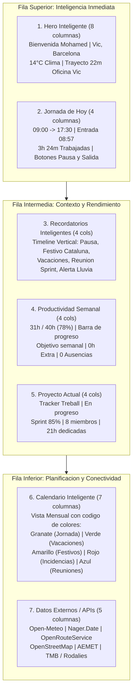

# Tracker Treball - Smart Work Assistant
**Especificacion Tecnica y Diseno de la Experiencia Premium del Dashboard**  
*Autor: Hassan Adraou*

---

## 1. Vision del Producto y Objetivo de Diseno

El widget central **Smart Work Assistant** se ubica en la cabecera del Dashboard principal de **Tracker Treball**. Su mision es transformar el tradicional panel aburrido de fichajes en una experiencia ejecutiva, fluida y contextual inspirada en los lideres del mercado de software de recursos humanos y productividad:

- **Factorial HR & Personio**: Claridad estructural, tarjetas limpias y separacion estricta de responsabilidades laborales.
- **Microsoft Viva Dashboard**: Inteligencia contextual, tarjetas adaptativas (*Adaptive Cards*) y anticipacion a las necesidades del empleado.
- **Google Workspace**: Tipografia cuidada, espaciados generosos y legibilidad maxima.
- **Institut de Vic**: Identidad institucional sobria, elegante y arraigada en el tejido empresarial catalan.

### El Objetivo de los 10 Segundos
Un empleado o directivo que abre la plataforma al comenzar su dia laboral debe ser capaz de obtener **toda la informacion critica de su jornada en menos de 10 segundos**:
1. Estado de su registro horario y salida prevista.
2. Estado de su trayecto a la oficina (tiempo de conduccion y trafico).
3. Recordatorios inmediatos (reuniones y pausas pendientes).
4. Avance de horas semanales frente al objetivo del convenio.

---

## 2. Sistema de Diseno (Design System)

### 2.1. Paleta de Colores Institucional

| Rol de Color | Valor Hex | Descripcion y Uso |
| :--- | :---: | :--- |
| **Primary** | `#A7333A` | Granate corporativo sobrio. Botones de accion principal, marcas de jornada y acentos. |
| **Primary Dark** | `#7A232B` | Granate oscuro para estados hover y encabezados de alta jerarquia. |
| **Background** | `#F5F5F3` | Gris calido suave de fondo que reduce la fatiga visual. |
| **Surface** | `#FFFFFF` | Blanco puro para tarjetas Bento Grid y modales elevados. |
| **Text Principal** | `#1D1D1D` | Gris carbon casi negro de maxima legibilidad y contraste WCAG AAA. |
| **Success** | `#2E7D32` | Verde bosque para vacaciones aprobadas y objetivos cumplidos. |
| **Warning** | `#F9A825` | Amarillo dorado para festivos y alertas de pausas pendientes. |
| **Danger** | `#C62828` | Rojo institucional para boton de fin de jornada e incidencias. |
| **Accent Blue** | `#1565C0` | Azul sereno para reuniones de equipo y eventos de calendario. |

### 2.2. Tipografia
- **Titulos y Logotipo**: `Montserrat` (pesos 600, 700 y 800) para transmitir solidez, modernidad e identidad institucional.
- **Cuerpo, Tablas y Numeros**: `Inter` (pesos 400, 500 y 600) para una lectura tecnica precisa y un renderizado impecable en pantallas de alta densidad.

### 2.3. Principios de Maquetacion (Bento Grid)
- Eliminacion total de tablas clasicas rigidas en el dashboard superior.
- Organizacion mediante **Bento Grid**: distribucion modular asimetrica donde el peso visual de cada bloque responde a su prioridad informativa.
- Bordes redondeados estandarizados a **16px** (`border-radius: 16px`).
- Sombras suaves multicapa (`box-shadow: 0 4px 16px rgba(0, 0, 0, 0.05)`).
- Cero iconos o emojis decorativos: diseno basado en tipografia de calidad, contraste y etiquetas de estado.

---

## 3. Desglose de las 7 Secciones del Bento Grid



---

## 4. Detalle de Secciones y Especificacion de Negocio

### 1. Seccion Hero Inteligente
- **Bienvenida contextual**: Saludo bilingue dinamico ("Bon dia, Mohamed" / "Buenos dias, Mohamed") que cambia segun la franja horaria.
- **Ubicacion y Clima**: Indicador de temperatura en tiempo real (14°C, Vic, Osona).
- **Asistente de Desplazamiento**: Conecta con la direccion del centro de trabajo asignado ("Oficina Central Vic"), calculando el tiempo estimado de viaje en vehiculo (22 minutos) y el estado del trafico ("Moderado") con boton para abrir la ruta en el mapa.

### 2. Seccion Jornada Laboral
- **Horario oficial**: Visualizacion del turno estipulado en contrato (09:00 a 17:30).
- **Entrada registrada**: Marca temporal certificada del fichaje de entrada (08:57).
- **Cronometro de trabajo efectivo**: Contador activo (3h 24m) que se actualiza programmaticamente cada minuto y descuenta automaticamente los descansos.
- **Salida prevista**: Calculo en tiempo real de la hora exacta de salida (17:30) para completar las 8 horas reglamentarias.
- **Acciones rapidas**: Boton secundario para alternar descansos ("Iniciar Pausa" / "Finalitzar Pausa") y boton primario de fin de jornada.

### 3. Seccion Recordatorios Inteligentes (Timeline Vertical)
Muestra avisos proactivos ordenados cronologicamente:
1. *Pausa pendiente*: Alerta preventiva al superar 3 horas continuadas de trabajo efectivo sin registrar pausa de descanso (prevencion de riesgos laborales).
2. *Festivo oficial en Cataluna*: Aviso de dia no laborable (ejemplo: Dilluns de Pasqua o Diada Nacional).
3. *Solicitud de vacaciones*: Informa del estado de aprobacion en el departamento de RRHH.
4. *Reuniones de equipo*: Aviso de sesion de coordinacion a las 11:00 horas.
5. *Condicion meteorologica*: Alerta de lluvias por la tarde emitida por AEMET para prever el regreso a casa.

### 4. Seccion Productividad
- **Progreso semanal acumulado**: 31 horas computadas de un objetivo legal de 40 horas.
- **Barra de progreso elegante**: Relleno visual con degradado granate corporativo que indica el 78% completado.
- **Indicadores de cumplimiento**: Metricas de horas extraordinarias (0h) y saldo de ausencias justificadas.

### 5. Seccion Proyecto Actual
- **Seguimiento de actividad**: Proyecto en curso ("Tracker Treball").
- **Metricas de entrega**: Estado en progreso, porcentaje de avance del sprint (85%), asignacion de equipo (8 companeros) e imputacion horaria del trabajador (21 horas imputadas).

### 6. Seccion Calendario Inteligente (Vista Mensual)
Calendario interactivo que unifica todos los eventos laborales del trabajador mediante la leyenda de color estipulada:
- **Granate (`#A7333A`)**: Jornada ordinaria realizada o planificada.
- **Verde (`#2E7D32`)**: Periodos de vacaciones aprobados.
- **Amarillo (`#F9A825`)**: Festivos nacionales y autonomicos de Cataluna.
- **Rojo (`#C62828`)**: Incidencias horarias (olvidos de fichaje o ausencias pendientes de justificar).
- **Azul (`#1565C0`)**: Reuniones agendadas con clientes o equipo.

### 7. Seccion Datos Externos (Hub de Integraciones API)
Widgets modulares que agregan informacion de fuentes publicas abiertas:
1. **Open-Meteo**: Datos de temperatura, viento y humedad sin requerir claves de pago.
2. **Nager.Date**: API publica de dias festivos oficiales con soporte para comunidades autonomas de Espana (`ES-CT`).
3. **OpenRouteService**: Calculo de matrices de distancia y tiempos de trayecto en carretera.
4. **OpenStreetMap / Nominatim**: Geolocalizacion inversa y representacion cartografica de centros de trabajo.
5. **AEMET**: Servicio meteorologico estatal para alertas tempranas de precipitacion o viento en la comarca de Osona.
6. **TMB / Rodalies de Catalunya**: Estado operativo de las lineas de transporte publico (Rodalies R3 / metro).

---

## 5. Arquitectura de Integracion Backend (Spring Boot 3)

Para evitar que una caida en una API externa (por ejemplo, AEMET o OpenRouteService) bloquee la carga del Dashboard, el backend utiliza el patron **Resilience4j Circuit Breaker** y peticiones reactivas no bloqueantes con `WebClient`:

```java
package com.trackertreball.dashboard.service;

import org.springframework.stereotype.Service;
import org.springframework.web.reactive.function.client.WebClient;
import io.github.resilience4j.circuitbreaker.annotation.CircuitBreaker;
import java.time.Duration;

@Service
public class ExternalWeatherService {

    private final WebClient webClient;

    public ExternalWeatherService(WebClient.Builder builder) {
        this.webClient = builder.baseUrl("https://api.open-meteo.com/v1").build();
    }

    @CircuitBreaker(name = "openMeteo", fallbackMethod = "obtenerClimaFallback")
    public WeatherDto consultarClimaVic() {
        return this.webClient.get()
            .uri("/forecast?latitude=41.93&longitude=2.25&current_weather=true")
            .retrieve()
            .bodyToMono(WeatherDto.class)
            .timeout(Duration.ofMillis(1500))
            .block();
    }

    public WeatherDto obtenerClimaFallback(Throwable t) {
        // En caso de corte o timeout devuelve la ultima lectura cacheada sin degradar la UI
        return new WeatherDto(14.0, "Dades no disponibles temporalment");
    }
}
```

---

## 6. Diseno Responsive y Puntos de Ruptura (Breakpoints)

| Dispositivo | Anchura de Pantalla | Estructura de la Rejilla | Experiencia de Usuario |
| :--- | :--- | :--- | :--- |
| **Escritorio (Desktop)** | Mas de 1100px | **Bento Grid de 12 columnas** | Vista completa de alta productividad. Todas las secciones visibles simultaneamente. |
| **Tablet (Horizontal/Vertical)** | Entre 681px y 1100px | **Bento Grid de 8 columnas** | Reordenacion fluida. Hero y Jornada al 100% de ancho, recordatorios y productividad en paralelo. |
| **Movil (Smartphones)** | Menos de 680px | **Columna unica apilada** | Jerarquia vertical estricta. Primero la tarjeta de Jornada para fichar rapidamente, seguida del Hero y los Recordatorios. |

---

## 7. Verificacion y Acceso Local

El codigo completo de este Dashboard se encuentra implementado y listo para su ejecucion en:
- Directorio: `Tracker-Treball/dashboard/`
- Interfaz HTML: [`Tracker-Treball/dashboard/index.html`](file:///c:/Users/adrao/Desktop/EEBO%20-%201r_A/EEBO/CURSO%20IRONHACK/Tracker-Treball/dashboard/index.html)
- Hoja de estilos: [`Tracker-Treball/dashboard/estilos.css`](file:///c:/Users/adrao/Desktop/EEBO%20-%201r_A/EEBO/CURSO%20IRONHACK/Tracker-Treball/dashboard/estilos.css)
- Logica JavaScript: [`Tracker-Treball/dashboard/dashboard.js`](file:///c:/Users/adrao/Desktop/EEBO%20-%201r_A/EEBO/CURSO%20IRONHACK/Tracker-Treball/dashboard/dashboard.js)

Se puede abrir directamente en el navegador con cualquier servidor local (como Live Server en el puerto 5500) para interactuar con el conmutador de idioma (Català / Castellano), pausar la jornada y revisar el diseno responsive.
